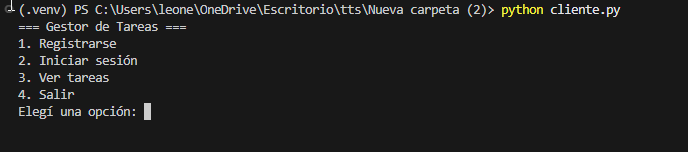
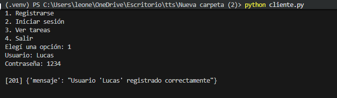
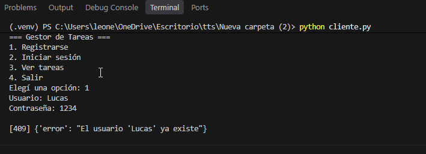
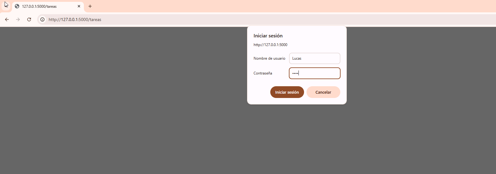
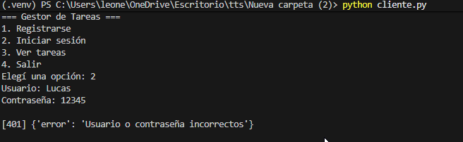
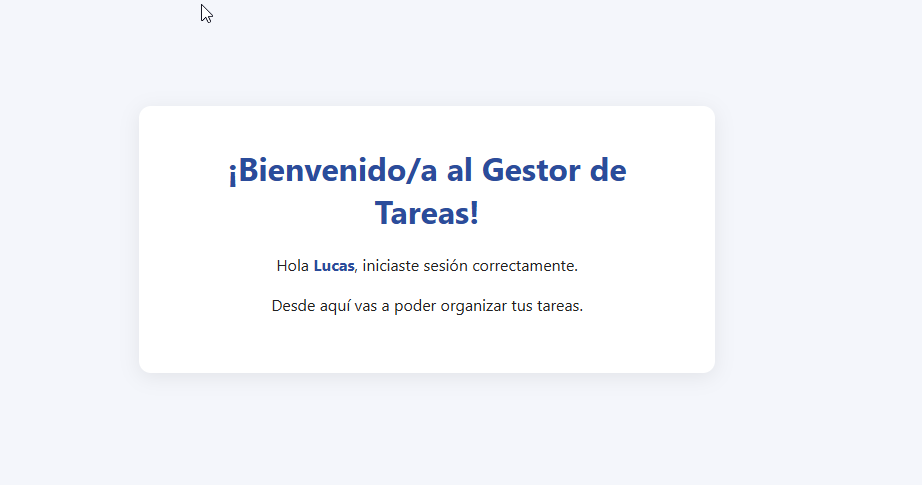

# PFO 2 – Sistema de Gestión de Tareas con API y Base de Datos

API REST hecha con **Flask** y **SQLite**, con registro e inicio de sesión de usuarios (contraseñas hasheadas) y un cliente de consola que interactúa con ella.

## Estructura del proyecto

```
├── capturas           # Capruras funcionamiento de las pantallas
├── servidor.py        # API Flask + SQLite
├── cliente.py         # Cliente de consola que consume la API
├── requirements.txt   # Dependencias
└── README.md
```

La base de datos `tareas.db` se crea automáticamente la primera vez que se ejecuta el servidor.

## Endpoints

| Método | Ruta        | Descripción                                                      |
|--------|-------------|------------------------------------------------------------------|
| POST   | `/registro` | Registra un usuario. Body: `{"usuario": "nombre", "contraseña": "1234"}` |
| POST   | `/login`    | Verifica las credenciales. Mismo body que `/registro`            |
| GET    | `/tareas`   | Devuelve un HTML de bienvenida. Requiere autenticación básica (HTTP Basic Auth) |

Códigos de respuesta: `201` usuario creado, `200` OK, `400` faltan datos, `401` credenciales inválidas, `409` usuario ya existente.

## Requisitos

- Python 3.9 o superior
- pip

## Instalación y ejecución

1. Clonar el repositorio y entrar a la carpeta:
   ```bash
   git clone https://github.com/<tu-usuario>/<tu-repo>.git
   cd <tu-repo>
   ```

2. (Opcional, recomendado) Crear y activar un entorno virtual:
   ```bash
   python -m venv venv
   # Windows
   venv\Scripts\activate
   # Linux / macOS
   source venv/bin/activate
   ```

3. Instalar dependencias:
   ```bash
   pip install -r requirements.txt
   ```

4. Iniciar el servidor:
   ```bash
   python servidor.py
   ```
   Queda escuchando en `http://127.0.0.1:5000`.

## Cómo probarlo

### Opción 1: Cliente de consola

Con el servidor corriendo, en otra terminal:

```bash
python cliente.py
```

Aparece un menú:

```
=== Gestor de Tareas ===
1. Registrarse
2. Iniciar sesión
3. Ver tareas
4. Salir
```

Registrarse (1), iniciar sesión (2) y luego ver tareas (3), que muestra el HTML de bienvenida.

### Opción 2: curl

```bash
# Registro
curl -X POST http://127.0.0.1:5000/registro -H "Content-Type: application/json" -d "{\"usuario\": \"ana\", \"contraseña\": \"1234\"}"

# Login
curl -X POST http://127.0.0.1:5000/login -H "Content-Type: application/json" -d "{\"usuario\": \"ana\", \"contraseña\": \"1234\"}"

# Tareas (con autenticación básica)
curl -u ana:1234 http://127.0.0.1:5000/tareas
```

> Las comillas escapadas (`\"`) funcionan tanto en Windows (CMD) como en Linux/macOS.

### Opción 3: Navegador

Abrir `http://127.0.0.1:5000/tareas`. El navegador pide usuario y contraseña; al ingresar los de un usuario registrado se ve la página de bienvenida.

También se puede probar con Postman o Thunder Client (pestaña *Authorization → Basic Auth* para `/tareas`).

### Resultados esperados

| Prueba                                   | Respuesta                                   |
|------------------------------------------|---------------------------------------------|
| Registrar usuario nuevo                  | `201` – "Usuario 'ana' registrado correctamente" |
| Registrar el mismo usuario otra vez      | `409` – "El usuario 'ana' ya existe"        |
| Login con contraseña correcta            | `200` – "Inicio de sesión exitoso..."       |
| Login con contraseña incorrecta          | `401` – "Usuario o contraseña incorrectos"  |
| `GET /tareas` sin credenciales           | `401`                                       |
| `GET /tareas` con credenciales válidas   | `200` – HTML de bienvenida                  |

En la base de datos la contraseña no se guarda en texto plano, sino como hash, por ejemplo:

```
scrypt:32768:8:1$rrMkPQJ9VWLLTcTm$4af3d90f63c7db47...
```

## Capturas de pantalla

### Inicio


### Registro de usuario


### Usuario duplicado


### Login correcto


### Login con contraseña incorrecta


### Página de bienvenida en /tareas


## Respuestas conceptuales

### ¿Por qué hashear contraseñas?

Porque nunca se debe guardar una contraseña en texto plano. Un hash es una función de un solo sentido: a partir de la contraseña se obtiene el hash, pero no se puede hacer el camino inverso. Para verificar el login, el servidor hashea la contraseña ingresada y la compara con el hash guardado, sin necesitar conocer la original.

Esto protege a los usuarios en varios escenarios:

- **Filtración de la base de datos:** si alguien roba el archivo `tareas.db`, no obtiene las contraseñas reales, solo hashes.
- **Reutilización de contraseñas:** muchas personas usan la misma contraseña en varios sitios; si se filtrara en texto plano, comprometería también sus otras cuentas.
- **Acceso interno:** ni siquiera los administradores del sistema pueden ver las contraseñas.

En este proyecto se usa `werkzeug.security` (`generate_password_hash` / `check_password_hash`), que aplica el algoritmo **scrypt** con una **sal** aleatoria por usuario. La sal hace que dos usuarios con la misma contraseña tengan hashes distintos e impide el uso de tablas precalculadas (*rainbow tables*), y scrypt es deliberadamente lento y costoso en memoria, lo que dificulta los ataques de fuerza bruta.

### Ventajas de usar SQLite en este proyecto

- **No requiere servidor:** la base de datos es un único archivo (`tareas.db`); no hay que instalar ni configurar un motor como MySQL o PostgreSQL.
- **Viene incluido en Python:** el módulo `sqlite3` es parte de la biblioteca estándar, no suma dependencias.
- **Persistencia real:** los datos sobreviven a reinicios del servidor, a diferencia de guardarlos en memoria.
- **Portabilidad:** el archivo se puede copiar, respaldar o mover entre sistemas operativos sin cambios.
- **Soporta SQL estándar:** permite usar restricciones como `UNIQUE` (evita usuarios duplicados) y consultas parametrizadas, que protegen contra inyección SQL.
- **Ideal para el tamaño del proyecto:** para una aplicación pequeña, de desarrollo o académica, con pocos usuarios concurrentes, ofrece todo lo necesario con mínima complejidad. Si el sistema creciera, migrar a otro motor SQL sería sencillo.
